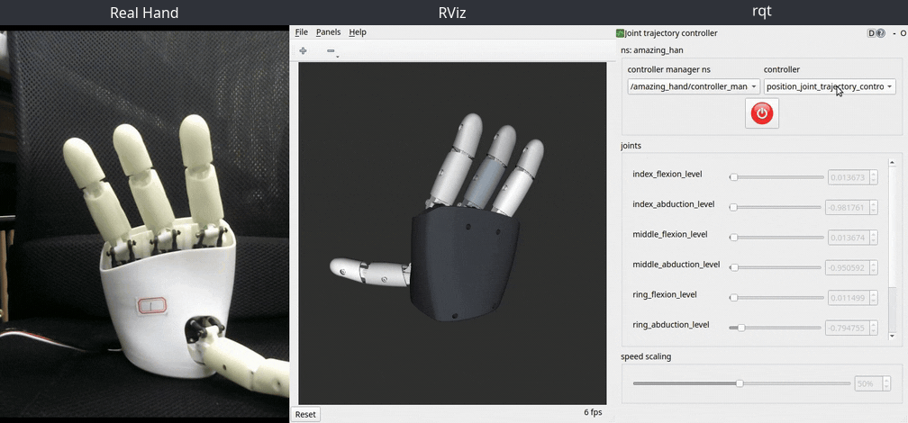
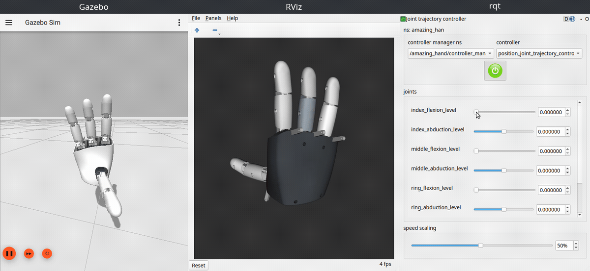

# amazing_hand_ros

ROS 1 and ROS 2 support for [AmazingHand](../README.md).

## Packages

| Package | Purpose | Usage guide |
| --- | --- | --- |
| [amazing_hand_driver](amazing_hand_driver/) | C++ ros_control / ros2_control hardware driver for the eight Feetech SCS0009 servos; accepts finger trajectories and publishes measured finger states | [Driver guide](#amazing_hand_driver) |
| [amazing_hand_description](amazing_hand_description/) | Left and right hand geometry, meshes, and simulation models | [Model guide](#amazing_hand_description) |

## Workspace setup

Place this repository at `src/AmazingHand` in your workspace. Use separate
workspaces and shells for ROS 1 and ROS 2. Run these commands from the
corresponding workspace root.

**ROS 1** (catkin)

```bash
source /path/to/ros1/setup.bash  # e.g. /opt/ros/one/setup.bash
rosdep install --from-paths src/AmazingHand/amazing_hand_ros --ignore-src -r -y
catkin build amazing_hand_driver
source devel/setup.bash
```

**ROS 2 Jazzy** (ament and colcon)

```bash
source /opt/ros/jazzy/setup.bash
vcs import src < src/AmazingHand/amazing_hand_ros/jazzy.repos
rosdep install --from-paths src --ignore-src -r -y
colcon build --symlink-install --packages-up-to amazing_hand_driver
source install/setup.bash
```

The ROS 2 hardware plugin uses the SCS0009 protocol library from the pinned
`feetech_ros2_driver` revision. ROS 1 uses the protocol implementation in
`amazing_hand_driver`.

## amazing_hand_driver

Each finger has two controls: **flexion** (bending, 0 to 1) and **abduction**
(sideways motion, −1 to 1). The driver accepts trajectories and reports measured
positions in these dimensionless levels. To try the interface without hardware,
start with [simulation](#simulation).

### Prepare and calibrate the hand

1. Assemble the hand, give each servo a unique ID, and calibrate each finger
   using Step 3 of the [assembly guide](../docs/AmazingHand_Assembly.pdf).
   The [Python setup notes](../PythonExample/README.md) cover servo configuration.
   The [middle-position helper](../PythonExample/AmazingHand_Hand_FingerMiddlePos.py)
   moves the selected servo pair during calibration.
   If you already calibrated this hand for the Python demo, reuse its eight
   `MiddlePos` angles. You can run the ROS driver independently of the demo.
2. If you used the Arduino calibration procedure and recorded raw encoder
   counts, convert each count to degrees with `(count - 511) * 300 / 1024`.
   Write down each servo's physical ID and its converted angle. These angles
   are the `MiddlePos` values you will use with the ROS driver in step 3.
3. Make a list of your eight `MiddlePos` angles in **ascending physical servo
   ID order**. You will give this list to the driver later as the `middle_pos`
   argument each time you start the hardware driver.
4. Connect the serial adapter and external power supply. Check read/write
   access to the port and close any other program using it. All servos must
   respond to READ at the same baud rate (default 1,000,000).

| Hand | Index IDs | Middle IDs | Ring IDs | Thumb IDs | Order of `middle_pos` |
| --- | --- | --- | --- | --- | --- |
| Right (`side:=1`) | 1, 2 | 3, 4 | 5, 6 | 7, 8 | IDs 1–8 |
| Left (`side:=2`) | 15, 16 | 13, 14 | 11, 12 | 17, 18 | IDs 11–18 |

For custom wiring, list `servo_ids` in **finger order** as in the table, motor 1
then motor 2 for each finger. Keep `middle_pos` in ascending ID order even if
`servo_ids` is unsorted.

### Start the driver

#### Hardware

Choose the command for your sourced workspace. Both examples start a right
hand with RViz and rqt. **Replace the example angles with your hand's
calibration** and select the port connected to its adapter.

**ROS 1**

```bash
roslaunch amazing_hand_driver amazing_hand.launch side:=1 port:=/dev/ttyACM0 \
  middle_pos:='[3, 0, -5, -8, -2, 5, -12, 0]' use_rviz:=true rqt:=true
```

**ROS 2**

```bash
ros2 launch amazing_hand_driver amazing_hand.launch.xml side:=1 port:=/dev/ttyACM0 \
  middle_pos:='[3, 0, -5, -8, -2, 5, -12, 0]' use_rviz:=true rqt:=true
```

At startup, the driver checks the measured positions against the level and
motor limits, sets those positions as hold targets, then enables and verifies
torque. The fingers can move as torque engages. Ctrl-C stops the launch and
requests torque off by default. A disconnected bus can prevent delivery.

The video shows the physical hand performing a gesture sequence alongside its
measured pose in RViz and its controller state in rqt.
You can also move the physical fingers from rqt. Select
`/amazing_hand/controller_manager` and `position_joint_trajectory_controller`,
then enable the sliders and adjust the desired finger's flexion or abduction.



#### Simulation

Gazebo runs the same eight-joint trajectory interface without a serial port or
calibration. Choose the command for your simulator.

**ROS 1 · Gazebo Classic**

```bash
roslaunch amazing_hand_driver amazing_hand.launch use_sim:=true use_rviz:=true rqt:=true
```

**ROS 2 · Gazebo Harmonic**

```bash
ros2 launch amazing_hand_driver amazing_hand.launch.xml use_sim:=true use_rviz:=true rqt:=true
```

In rqt, select `/amazing_hand/controller_manager` and
`position_joint_trajectory_controller`, then enable the sliders. The video
shows the fingers following a flexion command in Gazebo and RViz.



#### Launch arguments

| Argument | Default | Meaning |
| --- | --- | --- |
| `side` | `1` | Hand model and default ID mapping (1 = right, 2 = left) |
| `servo_ids` | Mapping for `side` | Eight unique physical IDs (0–253) in finger/motor order |
| `middle_pos` | Required for hardware | Eight measured angles for the connected hand in degrees, in ascending physical servo ID order. Simulation ignores this argument. |
| `namespace` | `amazing_hand` | Scopes the controllers, topics and action. For example, `namespace:=robot/left_hand` places feedback at `/robot/left_hand/joint_states`. Joint names stay the same. |
| `port`, `baudrate` | `/dev/ttyACM0`, `1000000` | Serial device and bus speed in bits/s |
| `serial_timeout` | `0.05` | Packet timeout in seconds, greater than 0 and at most 5 |
| `control_rate` | `50` | Hardware loop frequency in Hz, greater than 0 and at most 1000. ROS 2 requires a whole number. |
| `goal_speed` | `3.0` | Requested servo speed in rad/s. Choose a positive speed that encodes to a nonzero register value. |
| `motor_min_deg`, `motor_max_deg` | `-90`, `90` | Motor limits relative to the calibrated middle pose. Absolute targets must fit in encoder counts 0–1023. |
| `disable_torque_on_shutdown` | `true` | Request torque off on normal shutdown |
| `use_sim`, `gui` | `false`, `true` | Run Gazebo and show its window. Set `gui:=false` for headless simulation. |
| `use_rviz`, `rqt` | `false`, `false` | Open the hand pose display and trajectory sliders, respectively |

### Send a finger trajectory and read feedback

In another terminal, source the same workspace. Try the following in simulation
first. Each command moves **all four fingers** to flexion 0.6 and centered
abduction over three seconds. The controller requires all eight joints. Set
`ns` to the hand namespace you launched.

**ROS 1** — publish one trajectory to the controller's command topic, then read
one measured joint state. Publishing returns after sending the message.

```bash
ns=/amazing_hand
rostopic pub -1 "$ns/position_joint_trajectory_controller/command" trajectory_msgs/JointTrajectory '
joint_names: [index_flexion_level, index_abduction_level, middle_flexion_level, middle_abduction_level,
              ring_flexion_level, ring_abduction_level, thumb_flexion_level, thumb_abduction_level]
points:
  - positions: [0.6, 0, 0.6, 0, 0.6, 0, 0.6, 0]
    time_from_start: {secs: 3, nsecs: 0}'

rostopic echo -n 1 "$ns/joint_states"
```

**ROS 2** — send the trajectory as an action goal, wait for its result, then
read one measured joint state.

```bash
ns=/amazing_hand
ros2 action send_goal "$ns/position_joint_trajectory_controller/follow_joint_trajectory" \
  control_msgs/action/FollowJointTrajectory '
trajectory:
  joint_names: [index_flexion_level, index_abduction_level, middle_flexion_level, middle_abduction_level,
                ring_flexion_level, ring_abduction_level, thumb_flexion_level, thumb_abduction_level]
  points:
    - positions: [0.6, 0, 0.6, 0, 0.6, 0, 0.6, 0]
      time_from_start: {sec: 3, nanosec: 0}'

ros2 topic echo --once "$ns/joint_states"
```

On either ROS version, use the trajectory action when your application needs
a completion result. Check the goal status and result error code. Success
means the controller's goal tolerances were met. Actual tracking depends on
servo speed, load and whether the requested pose is reachable.

### Understand levels and reachable poses

AmazingHand uses two motors per finger in a parallel mechanism. This driver
represents their difference and sum as flexion and abduction levels; it does not
solve the mechanism's anatomical joint angles.

Let `a` and `b` be the two motor angles **in degrees after subtracting their
middle_pos offsets**:

```text
flexion_level   = ((a - b) / 2 + 45) / 135
abduction_level =  (a + b) / (2 * 47)

a = -45 + 135 * flexion_level + 47 * abduction_level
b =  45 - 135 * flexion_level + 47 * abduction_level
```

Useful reference poses for one finger:

| Pose | Motor angles (a, b) | Flexion | Abduction |
| --- | --- | --- | --- |
| Maximum extension in the level range | (-45°, +45°) | 0 | 0 |
| Open pose used by PythonExample's `OpenHand` | (-35°, +35°) | 10/135 ≈ 0.0741 | 0 |
| Calibrated middle pose | (0°, 0°) | 1/3 | 0 |
| Closed pose used by `CloseHand` | (+90°, -90°) | 1 | 0 |
| A sideways pose used by `SpreadHand` | (+4°, +90°) | 2/135 ≈ 0.0148 | +1 |

Flexion 0 includes poses more extended than the demo's `OpenHand`.
The sideways scale of 47° corresponds to half the motor-angle sum in the last row.
Positive abduction follows the motor-angle sum, so its physical direction depends
on the finger and hand; it does not universally mean "spread away from the middle
finger."

#### Command limits and feedback

Commands are first clamped to the level ranges, then each calibrated motor angle
is clamped to `motor_min_deg` / `motor_max_deg` (default: -90° / +90°).

With the default motor limits, a pair of levels `f` (flexion, 0 to 1) and `s`
(abduction, -1 to 1) is within both motor limits exactly when:

```text
abs(-45 + 135*f) + abs(47*s) <= 90
```

This describes the software motor-angle limits, not a guarantee that the physical
mechanism can attain every such pose under load or without interference.

For example, `f=1, s=1` exceeds the motor limits. The ROS 1 driver warns when a command
is clamped. If the resulting pose violates the trajectory controller's tolerances,
the action fails rather than reporting successful arrival at the requested pose.

`/amazing_hand/joint_states` reports transformed **measured** positions without clamping, so
feedback can lie outside the command ranges. Its units are:

| Field | Units / behavior |
| --- | --- |
| Position | Dimensionless level |
| Velocity | Level/s, estimated from position differences |
| Effort | Always 0; not measured |
| Trajectory acceleration, if supplied | Level/s² |

The motor's goal-speed setting is programmed from `goal_speed` in rad/s; it is not
a measured or guaranteed speed. Trajectory timing sets the requested rate of
motion in level space. The URDF velocity limits are descriptive and are
not enforced as software velocity or acceleration limiters by this driver.

### ROS interfaces

Names are relative to the hand namespace (default `/amazing_hand`).

| Name | ROS 1 type | ROS 2 type | Purpose |
| --- | --- | --- | --- |
| `joint_states` | `sensor_msgs/JointState` | `sensor_msgs/msg/JointState` | Read measured levels and velocities |
| `position_joint_trajectory_controller/follow_joint_trajectory` | `control_msgs/FollowJointTrajectoryAction` | `control_msgs/action/FollowJointTrajectory` | Send a trajectory and obtain its result |
| `position_joint_trajectory_controller/command` | `trajectory_msgs/JointTrajectory` | `trajectory_msgs/msg/JointTrajectory` | Send a trajectory on a topic |
| `position_joint_trajectory_controller/state` | `control_msgs/JointTrajectoryControllerState` | `control_msgs/msg/JointTrajectoryControllerState` | Compare reference and measured motion |
| `controller_manager/list_controllers` | `controller_manager_msgs/ListControllers` | `controller_manager_msgs/srv/ListControllers` | Inspect loaded controllers and their states |

The ROS 2 launch file remaps the controller topics to the names above. Set
controller rates and trajectory tolerances in [ros_controllers.yaml](amazing_hand_driver/config/ros_controllers.yaml)
for ROS 1 or [ros2_controllers.yaml](amazing_hand_driver/config/ros2_controllers.yaml)
for ROS 2.

### Troubleshooting

| Symptom | What to check |
| --- | --- |
| Cannot open or lock the serial port | Device path, user permissions, and other programs using the port |
| Serial timeout | Hand power, adapter connection, servo IDs, baud rate, and READ response settings |
| Initial pose outside configured limits | `middle_pos` values and ordering, `servo_ids` mapping, and the hand's starting pose |
| Command saturation warning | The combined flexion/abduction target and configured motor limits |
| Trajectory tolerance failure | Reachable target, sufficient trajectory duration, motor speed, and controller tolerances |

During operation, communication errors, invalid replies, servo error flags, or
non-finite commands stop the control loop. The driver attempts to disable torque
on faults. On ROS 2 the hardware plugin returns an error to controller_manager.
On ROS 1 the driver exits. Because the ROS 1 driver is a required node, its failure shuts down the
entire containing roslaunch, including other nodes if this launch is included in
a larger robot launch. It does not reconnect automatically.
A disconnected bus can prevent the torque-disable command from reaching the hand.

Position reads are sequential, while target positions are sent together using
SyncWrite. On ROS 1, communication errors include the operation and register address;
READ errors also identify the servo ID. Serial latency can reduce the actual
loop rate below `control_rate`; this is not a hard-real-time driver.

### URDF and transmission details

The ROS 1 and ROS 2 hardware descriptions both include the hand geometry from
`amazing_hand_description`. The eight level joints drive the CAD
links through URDF mimic joints. The hardware descriptions add four differential
transmissions to map servo positions to levels. The visual hinges approximate
the mechanism around the CAD reference pose.

Each finger uses the standard
`transmission_interface/DifferentialTransmission` with:

| Parameter | Value |
| --- | --- |
| Actuator reductions | `[1, -1]` |
| Joint reductions | `[135*pi/180, 47*pi/180]` |
| Joint offsets | `[45/135, 0]` |

The driver loads these transmissions from the URDF for both feedback and command
conversion. Actuator positions entering the transmission are calibrated radians;
the driver subtracts `middle_pos` before feedback conversion and adds it back
after command conversion. No custom transmission plugin is required.

| Control component | ROS 1 | ROS 2 |
| --- | --- | --- |
| Command interface | `hardware_interface::PositionJointInterface` | `position` command interface |
| Joint state publisher | `joint_state_controller/JointStateController` | `joint_state_broadcaster/JointStateBroadcaster` |
| Trajectory controller | `position_controllers/JointTrajectoryController` | `joint_trajectory_controller/JointTrajectoryController` |

### Test without a hand

From the corresponding workspace root, run the tests for your ROS version.

**ROS 1**

```bash
source devel/setup.bash
catkin build amazing_hand_driver --catkin-make-args run_tests
catkin_test_results build/amazing_hand_driver/test_results
```

**ROS 2**

```bash
source install/setup.bash
colcon test --packages-select amazing_hand_driver --return-code-on-test-failure
colcon test-result --verbose
```

Tests use generated pseudo-terminals, not physical serial devices. They cover
packet validation, unit conversion, URDF transmission conversion, serial timeouts,
both hand mappings, default and custom launch namespaces, trajectory execution,
state feedback, shutdown, and
communication-fault handling. These checks do not replace validation on hardware.

To inspect the launch configuration from the command line:

```bash
# ROS 1
roslaunch --dump-params amazing_hand_driver amazing_hand.launch \
  middle_pos:='[3,0,-5,-8,-2,5,-12,0]'
# ROS 2
ros2 launch amazing_hand_driver amazing_hand.launch.xml --show-args
```

## amazing_hand_description

To generate a standalone URDF, select `right_hand` or `left_hand` when expanding the Xacro.

```bash
# ROS 1
share="$(rospack find amazing_hand_description)"
```

```bash
# ROS 2
share="$(ros2 pkg prefix --share amazing_hand_description)"
```

With `share` set for your ROS version, generate the model:

```bash
xacro "$share/urdf/amazing_hand.urdf.xacro" hand_name:=left_hand > left_hand.urdf
```

### AmazingHand models

The URDF geometry is adapted from `ah_to_ros2_bridge/amazinghand_description`.
The mechanical design and meshes are by Pollen Robotics and are licensed under
[CC BY 4.0](https://creativecommons.org/licenses/by/4.0/).

The URDF represents the distal and coupler hinges as passive mimic joints
linearized around the CAD reference pose. The standalone models below include
closed-loop linkage geometry. Use `show_covers:=false` when expanding the Xacro
to inspect the internal geometry.

#### MuJoCo

```sh
# Use the share directory selected above.
python -m mujoco.viewer --mjcf="$share/mjcf/right_hand.xml"
```

Use `left_hand.xml` for the left hand. Motor names range from
`finger1_motor1` to `finger4_motor2`, in index, middle, ring, and thumb order.

## Licenses and attribution

License and attribution information is provided within each package.

The `amazing_hand_driver` package is licensed under
[Apache-2.0](amazing_hand_driver/LICENSE). Its ROS 1 SCS0009 protocol
implementation adapts position/speed conversion, READ, and SyncWrite from
[rustypot](https://github.com/pollen-robotics/rustypot).
See [NOTICE](amazing_hand_driver/NOTICE) for attribution and the source revision.
