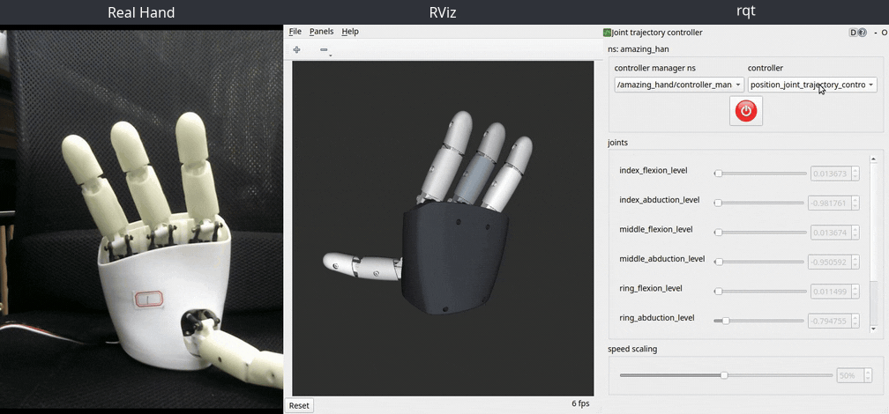
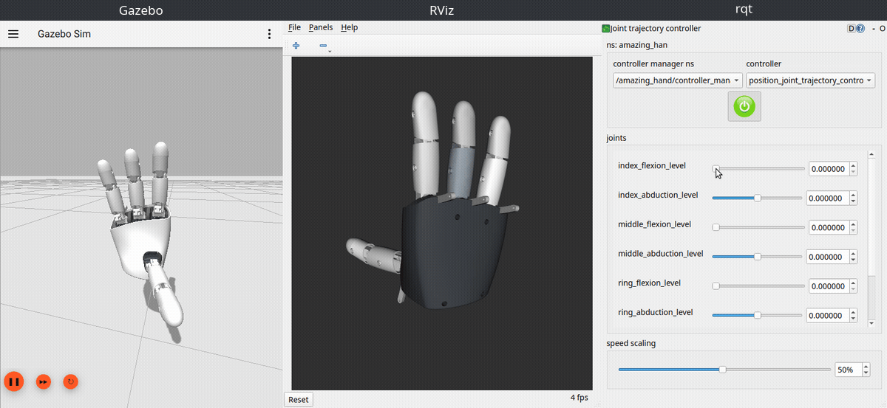

# amazing_hand_ros2

ROS 2 support for [AmazingHand](../README.md).

## Packages

| Package | Purpose |
| --- | --- |
| [amazing_hand_driver](amazing_hand_driver/) | Controls eight Feetech SCS0009 servos through `ros2_control`, accepts finger trajectories, and publishes measured joint states. |
| [amazing_hand_description](amazing_hand_description/) | Provides left and right hand URDF/Xacro models and meshes for ROS, plus standalone MJCF and SDF models for simulation. |

## Setup

Set `ROS_DISTRO` to your installed ROS 2 distribution (for example, `export ROS_DISTRO=jazzy`) if it is unset.

```bash
source "/opt/ros/${ROS_DISTRO}/setup.bash"
mkdir -p ~/colcon_ws/src
cd ~/colcon_ws
git clone https://github.com/pollen-robotics/AmazingHand.git src/AmazingHand
vcs import src < src/AmazingHand/amazing_hand_ros2/jazzy.repos
rosdep install --from-paths src --ignore-src -y
colcon build --packages-up-to amazing_hand_driver
source ~/colcon_ws/install/setup.bash
```

## amazing_hand_driver

### Prepare and calibrate the hand

| Step | What to check |
| --- | --- |
| Connect | Assemble and power the hand, connect the serial adapter, and check read/write access to its device. Close any demo using the same port. [Assembly guide](../docs/AmazingHand_Assembly.pdf) |
| Set servo IDs | Give each motor a unique ID and set all eight to the same baud rate (default 1,000,000). [Servo setup](../PythonExample/README.md) |
| Record the middle pose | Use your hand’s measured `MiddlePos` values from the Python demo, or calibrate each pair and record its two angles in degrees. The calibration helper moves the selected motors. [Calibration helper](../PythonExample/AmazingHand_Hand_FingerMiddlePos.py) |
| Save the calibration | Store a YAML mapping of physical servo ID to measured angle in `~/.config/amazing_hand_ros/right_hand.yaml` or `left_hand.yaml`. A launch-time `middle_pos` list overrides the file. |

| Hand | Index IDs | Middle IDs | Ring IDs | Thumb IDs | Order of `middle_pos` |
| --- | --- | --- | --- | --- | --- |
| Right (`side:=1`) | 1, 2 | 3, 4 | 5, 6 | 7, 8 | IDs 1–8 |
| Left (`side:=2`) | 15, 16 | 13, 14 | 11, 12 | 17, 18 | IDs 11–18 |

For custom wiring, pass `servo_ids` in finger order (index, middle, ring, thumb), with motor 1 then motor 2 for each finger. Sort `middle_pos` by ascending physical ID even with a custom mapping.

### Start the driver

```bash
# Right hand with RViz and rqt, using the saved calibration
ros2 launch amazing_hand_driver amazing_hand.launch.xml side:=1 port:=/dev/ttyACM0 use_rviz:=true rqt:=true
```

The right hand makes rock, paper, and scissors gestures, then waves its fingers from side to side. The USB camera shows the hand, RViz displays its measured pose, and rqt tracks the joint positions.



```bash
# Left hand in a custom namespace, using the saved left-hand calibration
ros2 launch amazing_hand_driver amazing_hand.launch.xml side:=2 namespace:=robot/left_hand
```

At activation the driver accepts measured joint levels up to 0.015 beyond either command limit, checks the motor angles, sets the eight measured positions as hold targets, then enables torque and verifies it on each servo. Ctrl-C stops the launch and requests torque off by default.

Simulate the hand in Gazebo, view its pose in RViz, and move its fingers with the rqt trajectory sliders.

```bash
ros2 launch amazing_hand_driver amazing_hand.launch.xml \
  use_sim:=true use_rviz:=true rqt:=true
```

In rqt, select `/amazing_hand/controller_manager` and `position_joint_trajectory_controller`, then click the power button to enable the sliders.



#### Launch arguments

| Launch argument | Default | Meaning |
| --- | --- | --- |
| `side`, `servo_ids` | `1`, side-specific IDs above | Hand model and eight unique physical IDs (0–253) in finger/motor order |
| `middle_pos` | `[]` | Read the calibration file on hardware, or supply eight angles in degrees |
| `namespace` | `amazing_hand` | Scope for nodes, controllers, topics and actions |
| `port`, `baudrate` | `/dev/ttyACM0`, `1000000` | Serial device and servo bus baud rate |
| `serial_timeout` | `0.05` | Packet timeout in seconds, greater than 0 and at most 5 |
| `control_rate` | `50` | Hardware update rate in Hz, integer from 1 to 1000 |
| `goal_speed` | `3.0` | Motor speed setting in rad/s |
| `motor_min_deg`, `motor_max_deg` | `-90`, `90` | Motor limits in degrees relative to calibration |
| `disable_torque_on_shutdown` | `true` | Request torque off on normal shutdown |
| `use_sim`, `gui` | `false`, `true` | Use Gazebo Harmonic and show its window |
| `use_rviz`, `rqt` | `false`, `false` | Show the measured pose in RViz or open trajectory sliders |

### Send a finger trajectory

With the right-hand driver running, open another terminal. This goal moves all four fingers to 0.6 flexion and centered abduction over three seconds. The controller requires all eight joints.

```bash
source ~/colcon_ws/install/setup.bash
ns=/amazing_hand

ros2 action send_goal \
  "$ns/position_joint_trajectory_controller/follow_joint_trajectory" \
  control_msgs/action/FollowJointTrajectory '
trajectory:
  joint_names: [
    index_flexion_level,  index_abduction_level,
    middle_flexion_level, middle_abduction_level,
    ring_flexion_level,   ring_abduction_level,
    thumb_flexion_level,  thumb_abduction_level
  ]
  points:
    - positions: [
        0.6, 0,  # index
        0.6, 0,  # middle
        0.6, 0,  # ring
        0.6, 0   # thumb
      ]
      time_from_start: {sec: 3}'

ros2 topic echo --once "$ns/joint_states"
```

### Levels and reachable poses

For each finger, `a` and `b` are motor angles in degrees relative to their calibrated middle positions. The differential transmission maps them to two dimensionless joint coordinates.

| Joint | Command range | Measured level |
| --- | --- | --- |
| `<finger>_flexion_level` | 0 to 1, increasing bend | `f = ((a - b) / 2 + 45) / 135` |
| `<finger>_abduction_level` | −1 to 1, centered at 0 | `s = (a + b) / 94` |

| Reference pose | Motor angles (a, b) | Flexion | Abduction |
| --- | --- | --- | --- |
| Maximum extension | −45°, +45° | 0 | 0 |
| Demo open | −35°, +35° | 10/135 | 0 |
| Calibrated middle | 0°, 0° | 1/3 | 0 |
| Demo closed | +90°, −90° | 1 | 0 |
| Demo sideways | +4°, +90° | 2/135 | +1 |

The inverse mapping is `a = -45 + 135*f + 47*s` and `b = 45 - 135*f + 47*s`. With the default ±90° motor limits, both targets are within range when `abs(135*f - 45) + abs(47*s) <= 90`. At full flexion, only centered abduction fits. The driver clamps commands first by level, then by motor angle. Feedback reports measured levels, which can fall outside the command ranges.

### ROS interfaces

| Interface under the hand namespace | Type | Use |
| --- | --- | --- |
| `joint_states` | `sensor_msgs/msg/JointState` | Position in levels, estimated velocity in levels/s, effort reported as zero |
| `position_joint_trajectory_controller/follow_joint_trajectory` | `control_msgs/action/FollowJointTrajectory` | Send a goal and receive its result |
| `position_joint_trajectory_controller/command` | `trajectory_msgs/msg/JointTrajectory` | Publish a trajectory |
| `position_joint_trajectory_controller/state` | `control_msgs/msg/JointTrajectoryControllerState` | Compare reference and feedback |

### Troubleshooting

| Symptom | Check |
| --- | --- |
| Serial port fails to open | Device path, permissions and other processes using the port |
| Activation reports an out-of-range pose | Calibration angles, ascending ID order in `middle_pos`, pair order in `servo_ids`, and starting pose |
| Action server unavailable | Run `ros2 control list_controllers -c /amazing_hand/controller_manager` and check the namespace and controller state |
| Goal misses its target | Check the coupled motor limits above and allow enough time for the motion |

## amazing_hand_description

To generate a standalone URDF, select `right_hand` or `left_hand` when expanding the Xacro.

```bash
share="$(ros2 pkg prefix --share amazing_hand_description)"
xacro "$share/urdf/amazing_hand.urdf.xacro" hand_name:=left_hand > left_hand.urdf
```

### AmazingHand models

The URDF geometry is adapted from `ah_to_ros2_bridge/amazinghand_description`.
The mechanical design and meshes are by Pollen Robotics and are licensed under
[CC BY 4.0](https://creativecommons.org/licenses/by/4.0/).

The URDF represents the distal and coupler hinges as passive mimic joints
linearized around the CAD reference pose. The standalone models below include
closed-loop linkage geometry. Use `show_covers:=false` when expanding the Xacro
to inspect the internal geometry.

#### MuJoCo

```sh
share="$(ros2 pkg prefix --share amazing_hand_description)"
python -m mujoco.viewer --mjcf="$share/mjcf/right_hand.xml"
```

Use `left_hand.xml` for the left hand. Motor names range from
`finger1_motor1` to `finger4_motor2`, in index, middle, ring, and thumb order.
